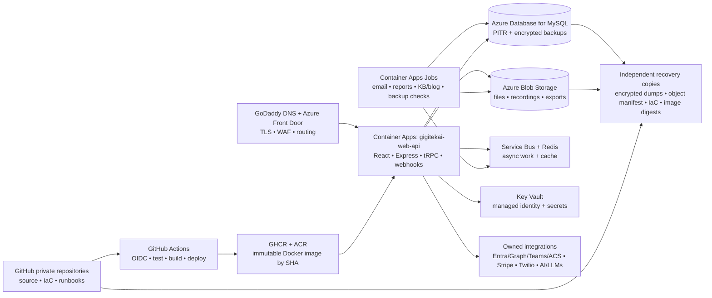

# GigitekAI Portable Hosting & Recovery Architecture

**Purpose.** This blueprint moves GigitekAI from platform-managed hosting to an architecture you control through a private GitHub repository, portable Docker images, independent cloud services, documented secrets, and repeatable recovery procedures. It is designed for the existing React, Express, tRPC, Drizzle/MySQL, Azure/Microsoft 365, Stripe, Teams, ACS, and AI-integrated portal—not just the public marketing site.

> **Core decision:** GitHub should be the **control plane** for source, reviews, infrastructure code, CI/CD, and container artifacts. It should **not** be the production runtime for this application. GitHub Pages is appropriate only for a static brochure site; the current portal needs a server runtime, relational database, secure secrets, webhooks, scheduled jobs, file storage, and durable observability.



## Executive Recommendation

Use an **Azure-first, GitHub-controlled** production design: GitHub private repository and Actions; portable Docker images; Azure Container Apps for runtime; Azure Database for MySQL Flexible Server; Azure Blob Storage; Azure Key Vault; Azure Service Bus; Azure Monitor/Application Insights; and GoDaddy-managed DNS. Keep an encrypted copy of container images, database dumps, object storage, infrastructure code, and secrets inventory outside the runtime account. This gives GigitekAI a clean fit with Microsoft 365, Entra ID, ACS, and Graph while ensuring the application can be rebuilt onto another Docker-capable platform if Azure is ever not the right answer.

Azure Container Apps can deploy revisions from GitHub Actions and can consume a Dockerfile or an existing image. GitHub Container Registry can retain OCI/Docker images associated with a private repository. Azure Container Apps can deploy an image from GHCR, although private registry authentication must be configured. [1] [2]

## 1. What Must Move

| Current capability | Portable target | Migration concern | Owner system of record |
|---|---|---|---|
| React 19 public site and admin portal | `web-api` Node container serving Vite build plus Express/tRPC | Remove platform-specific runtime assumptions | Private GitHub repository |
| Express, tRPC, Socket.IO, webhooks | Same `web-api` container; scale-aware WebSocket design | Add Redis adapter or Azure Web PubSub before multi-replica realtime scale | Docker image |
| TiDB/MySQL data | Azure Database for MySQL Flexible Server | Export schema, data, users/roles, and validate application queries | Managed MySQL + encrypted backups |
| Manus object-storage proxy | Azure Blob Storage with a local storage adapter | Copy files and preserve object-key mapping/checksums | Blob Storage + second copy |
| Manus OAuth and owner notifications | Microsoft Entra ID/OIDC + direct email/Teams notification services | Replace platform login, owner ID, and notification dependency | Entra app registration + Graph/ACS |
| Built-in LLM, image, data, notification APIs | Azure AI / Azure OpenAI, Anthropic, Gemini, Ollama gateway, direct APIs | Replace vendor-specific helpers one capability at a time | Provider credentials held in Key Vault |
| Scheduled tasks and pollers | Container Apps Jobs, Service Bus workers, or Azure Functions | Avoid in-process timers that disappear on a restart | GitHub/IaC-defined schedules |
| CI/CD and release versions | GitHub Actions, GHCR + ACR dual publishing, Terraform or Bicep | Require protected branch, reviews, immutable image tags | GitHub |
| Custom domains and TLS | GoDaddy DNS → Azure Front Door or Container Apps custom domain | Lower DNS TTL before cutover; maintain rollback record | GoDaddy + Azure certificate configuration |

The existing application is materially more than a site. It has a relational data model supporting admin functions, helpdesk and tickets, blog/CMS, chat, call-center/voice records, transcripts, forms, and operational analytics. Therefore, a static-host move alone would break core business functions.

## 2. Recommended Reference Architecture

### A. GitHub: the portable control plane

Create a **private GitHub organization** and keep the application repository private. Protect `main`; require pull requests, status checks, and manual approval for production deployments. Store no production secrets in GitHub source or workflow files.

GitHub Actions runs three independently versioned workflows:

1. **Pull-request workflow:** install dependencies, run type checks, unit tests, build the image, run vulnerability scanning, and publish no deployment.
2. **Production workflow:** after approval, build a Docker image tagged with the commit SHA, publish to GHCR and Azure Container Registry, apply infrastructure changes, deploy a new container revision, run smoke tests, and retain the prior revision for rollback.
3. **Recovery workflow:** manually runs backup validation, database-restore drills, object-store inventory checks, and image restore tests.

Use GitHub OIDC workload identity federation to Azure rather than a long-lived Azure credential stored in GitHub. GitHub documents that OIDC lets Actions obtain cloud access without storing long-lived Azure credentials, and recommends restricting token issuance with predictable trust conditions. [3]

### B. Runtime: portable Docker containers

Build a standard multi-stage Node 22 Docker image. The image must accept `PORT`, run as a non-root user, expose `/healthz` and `/readyz`, and contain no secrets. One image should run locally with Docker Compose, in Azure Container Apps, on AWS ECS/Fargate, on a Kubernetes cluster, or on a conventional VM.

Start with **two deployables**:

| Container | Responsibility | Availability model |
|---|---|---|
| `gigitekai-web-api` | React static assets, Express/tRPC API, secure webhooks, admin portal, public site | Minimum one warm replica; health-probed; rolling revision deployment |
| `gigitekai-worker` | Email pollers, scheduled reporting, KB/blog jobs, import/export, background notifications | Run as scheduled or event-driven jobs; never depend on web process memory |

For early production, preserve Socket.IO/WebRTC signaling in the web container with one active replica. Before horizontally scaling realtime features, move shared sessions/presence to Redis and use a Socket.IO Redis adapter, or adopt Azure Web PubSub. This prevents message delivery and chat-presence state from fragmenting across replicas.

Azure Container Apps Jobs are a natural replacement for finite or scheduled work; jobs can run manually, on a cron schedule, or from events, while continuously running HTTP APIs remain Container Apps. [4]

### C. Data, files, and state

**Database.** Use Azure Database for MySQL Flexible Server with private networking, TLS enforcement, and a dedicated least-privilege application user. It is compatible with the application's MySQL/Drizzle approach and includes automatic backups with point-in-time restore for a configurable retention period, plus local or zone-redundant high availability options. [5]

**Object storage.** Replace the current platform storage proxy with a small storage interface implemented against Azure Blob Storage. Store attachments, recordings, exports, generated media, and uploaded documents by immutable object key; keep only object metadata and authorization state in MySQL. Blob Storage supports object access over HTTPS and is designed for backup, recovery, archiving, and serving files. [6]

**Queue and cache.** Use Azure Service Bus for durable asynchronous work—voice transcription, email processing, document generation, Teams notifications, and long-running AI jobs. Use Azure Cache for Redis only for ephemeral cache, rate-limit counters, session/realtime coordination, and Socket.IO adapters; never make Redis the only copy of business data.

### D. Identity, secrets, and integrations

Replace platform login dependencies with a first-party Microsoft Entra ID app registration. Use OIDC authorization-code flow for administrator access, enforce admin access through an Entra group or application role, and retain application JWTs only where needed for service-to-service paths. Keep client-facing support/customer access as a separate authentication domain rather than sharing admin authorization.

Place API keys, Graph client secrets, Stripe signing secrets, Teams webhook URLs, ACS/Twilio keys, Azure AI credentials, and other third-party values in Azure Key Vault. The runtime should access Key Vault through a managed identity, not through secrets embedded in a container image or source file. Key Vault is designed for storing and controlling access to keys, credentials, and secrets, and Microsoft recommends managed identity where possible. [7]

### E. Networking, domain, and security edge

Keep GoDaddy as the source of truth for DNS. Point `gigitekai.com`, `www`, and private subdomains to an Azure Front Door endpoint or directly to Container Apps during the first cutover. The recommended production edge is **Azure Front Door Premium → Container Apps** because it adds a WAF, managed TLS, health-based routing, and a clean place to later add a secondary origin. You can begin with Container Apps custom domains if you want fewer moving pieces.

Container Apps supports custom domain bindings. Apex domains require an A record and verification TXT record; subdomains use CNAME plus verification TXT. Every bound domain needs a certificate. [8]

## 3. Concrete Target Layout

```text
GitHub Organization (private)
├── gigitekai-app/                 # application source, Dockerfile, IaC, tests
├── gigitekai-infra/               # optional separate Terraform/Bicep repository
├── gigitekai-runbooks/            # recovery runbooks, inventory, operating procedures
└── GitHub Actions + GHCR          # CI, signed images, release history

Azure Subscription / Resource Group: rg-gigitekai-prod
├── Azure Front Door + WAF
├── Azure Container Apps Environment
│   ├── gigitekai-web-api
│   └── scheduled/event jobs: email-poller, kb-job, backup-validator, reports
├── Azure Container Registry       # deployment-local image cache
├── Azure Database for MySQL Flexible Server
├── Azure Storage Account
│   ├── app-files
│   ├── database-backups
│   └── recovery-manifests
├── Azure Service Bus
├── Azure Cache for Redis
├── Azure Key Vault
├── Application Insights + Log Analytics
└── Microsoft Entra ID app registrations / managed identities

Independent recovery copies
├── GHCR images by immutable digest
├── encrypted MySQL logical dumps copied to a second cloud/bucket
├── encrypted Blob inventory + object copies in a second provider
└── offline recovery kit in business password manager
```

## 4. Portability Rules That Prevent the Next Lock-In

| Rule | Implementation standard |
|---|---|
| No provider API in business logic | Use thin adapters: `storage`, `email`, `llm`, `queue`, `auth`, and `notifications` interfaces. |
| No hidden runtime state | Keep durable state in MySQL, Blob Storage, or Service Bus; do not rely on container disk or in-memory timers. |
| Immutable releases | Tag every image as `git SHA`; deploy by image digest; retain the prior successful revision. |
| Rebuild from code | Terraform/Bicep must recreate networking, apps, identities, database settings, alerts, and DNS instructions. |
| Secrets are not backups | Key Vault keeps active values; a separate encrypted secrets inventory documents the owner, rotation process, and recovery procedure without exposing secret values. |
| Backups are worthless until restored | Test a MySQL restore and an object-file restore monthly. Record actual RTO/RPO results. |
| Exit route stays tested | Run Docker Compose locally from the same tagged image at least quarterly. |

## 5. Backup and Disaster-Recovery Design

### Recovery objectives to adopt

Set these as operating targets, then test them rather than treating them as marketing claims.

| Asset | Recovery point objective | Recovery time objective | Backup method |
|---|---:|---:|---|
| Source, IaC, runbooks | Last merged commit | Under 1 hour | Private GitHub repo + mirrored encrypted clone |
| Container image | Last production commit | Under 1 hour | GHCR + ACR image retention by digest |
| MySQL business data | 15 minutes to 24 hours, based on workload tier | 2–4 hours | Managed PITR + nightly encrypted logical dump to second provider |
| Uploaded files/recordings | 24 hours | 2–4 hours | Blob versioning/retention + nightly manifest and cross-provider copy |
| Secrets and integrations | Current documented version | 1–2 hours | Key Vault + offline secret inventory and rotation runbook |
| Domains, DNS, TLS | Current zone export | Under 1 hour | GoDaddy DNS export + documented cutover records |

### Required backup jobs

1. **Nightly database export:** run `mysqldump --single-transaction --routines --events`, encrypt it, checksum it, store it in a non-public Blob container, and replicate it to an independent bucket. Keep daily, weekly, and monthly retention tiers.
2. **Object-storage manifest:** export key, size, SHA-256, metadata, and retention status; copy changed objects to a second provider. Restore by manifest, not guesswork.
3. **Infrastructure state backup:** version Terraform/Bicep; encrypt and replicate the Terraform state; never rely on a local workstation state file.
4. **Secrets inventory:** record secret names, owning system, application registration, permissions, rotation date, and recovery owner. Do not export raw secret values into Git.
5. **Recovery drill:** quarterly, create an isolated MySQL restore, deploy the last good image, restore a small object sample, and prove that admin login, a form submission, and a webhook work.

## 6. Migration Plan: Low-Risk, No Big-Bang Move

### Phase 0 — Freeze and inventory (1–2 days)

Create a private GitHub backup of the current code, archive release tags, export the Drizzle schema, list tables and row counts, inventory file prefixes, record every environment variable by **name and owner**, export GoDaddy DNS, and capture current webhook endpoints. Rotate any secret that has been pasted into notes, chat, or source history before migration.

### Phase 1 — Make the code portable (3–7 days)

Add a Dockerfile, `.dockerignore`, `docker-compose.yml`, health endpoints, an externalized configuration schema, and adapters for storage, identity, notifications, and LLM calls. Remove platform-only code in priority order: built-in storage, owner notification service, OAuth portal dependency, and built-in LLM/data APIs. Preserve existing routes and database schemas during this phase.

### Phase 2 — Stand up independent production foundations (2–4 days)

Provision the Azure resource group using IaC. Create Key Vault, MySQL, Blob Storage, Service Bus, Redis, Container Apps, App Insights, and the Entra app registration. Configure GitHub OIDC, environment approvals, GHCR, and ACR. Do **not** point the production domain yet.

### Phase 3 — Data and integration migration (2–5 days)

Run a rehearsal MySQL export/import into the target. Copy current object-storage files into Blob Storage using a manifest with checksums. Update direct integrations: Microsoft Graph, ACS, Teams, Stripe webhooks, Twilio, UptimeRobot, GoDaddy, Anthropic/Gemini, and any Ollama gateway. For every connector that was platform-managed, replace it with an owned app registration, API key, webhook, or OAuth client before cutover.

### Phase 4 — Parallel validation (3–7 days)

Use a staging domain such as `staging.gigitekai.com`. Execute a client-safe test matrix: public pages, form submission/confirmation/Teams alert, admin login, helpdesk ticket, file upload/download, Stripe webhook signature validation, call webhook, scheduled jobs, monitoring alert, backup restore, and log tracing. Keep Manus live as the production fallback until this matrix passes.

### Phase 5 — Cutover and rollback window (1 day)

Lower DNS TTL to 300 seconds 24–48 hours before cutover. Freeze write-heavy imports briefly, run a final database and object sync, switch GoDaddy records to the new edge, then confirm production health checks and core business flows. Keep the old production endpoint untouched for at least seven days. If a critical flow fails, restore the prior DNS record and investigate without data loss.

## 7. What Not to Do

Do **not** move this full portal to GitHub Pages. It cannot host your server-side API, authenticated portal, MySQL access, webhooks, background jobs, or secure secret processing.

Do **not** run MySQL, files, cron, and production containers on one unmanaged VM as the primary plan. A single Docker Compose VM is valuable as a disaster-recovery and local-dev target, but it is a single point of failure unless you take on database, patching, monitoring, TLS, offsite backup, and failover operations yourself.

Do **not** place Azure, Stripe, Graph, or Teams secrets in a repository, Docker image, frontend environment variable, or browser storage. Keep only public client configuration in the frontend.

## 8. Recommended First 10 Deliverables

1. Private GitHub organization and repository protection rules.
2. Current-state backup: code, database export, object inventory, DNS export, secret-name inventory.
3. Dockerfile and Docker Compose that run the portal locally.
4. CI workflow: lint/typecheck/test/build/image scan.
5. GHCR image publishing with immutable SHA tag and digest release record.
6. Terraform/Bicep for Azure foundation and separate staging/production environments.
7. Azure Key Vault and managed-identity migration for all server-side secrets.
8. Azure Blob adapter replacing the current storage proxy, plus migration manifest.
9. Scheduled Container Apps Jobs replacing in-process/platform schedules.
10. A staged cutover runbook with go/no-go checks, rollback DNS record, and restore validation.

## 9. Bottom-Line Decision

For GigitekAI, the best balance is **GitHub + Docker + Azure PaaS**, not GitHub-only hosting and not a single self-managed VM. GitHub gives you ownership of source and releases; Docker gives you runtime portability; Azure reduces the operations burden while matching your Microsoft 365, Entra, Graph, ACS, and compliance-oriented service model. A Docker Compose recovery configuration and independent backup copies give you a credible exit path from both the current platform and Azure.

## References

[1]: https://learn.microsoft.com/en-us/azure/container-apps/github-actions "Deploy to Azure Container Apps with GitHub Actions"
[2]: https://docs.github.com/packages/working-with-a-github-packages-registry/working-with-the-container-registry "GitHub Container Registry"
[3]: https://docs.github.com/actions/deployment/security-hardening-your-deployments/configuring-openid-connect-in-azure "Configuring OpenID Connect in Azure"
[4]: https://learn.microsoft.com/en-us/azure/container-apps/jobs "Jobs in Azure Container Apps"
[5]: https://learn.microsoft.com/en-us/azure/mysql/flexible-server/overview "Azure Database for MySQL Flexible Server"
[6]: https://learn.microsoft.com/en-us/azure/storage/blobs/storage-blobs-introduction "Introduction to Azure Blob Storage"
[7]: https://learn.microsoft.com/en-us/azure/key-vault/general/basic-concepts "Azure Key Vault Basic Concepts"
[8]: https://learn.microsoft.com/en-us/azure/container-apps/custom-domains-certificates "Custom Domain Names and Bring-Your-Own Certificates in Azure Container Apps"
